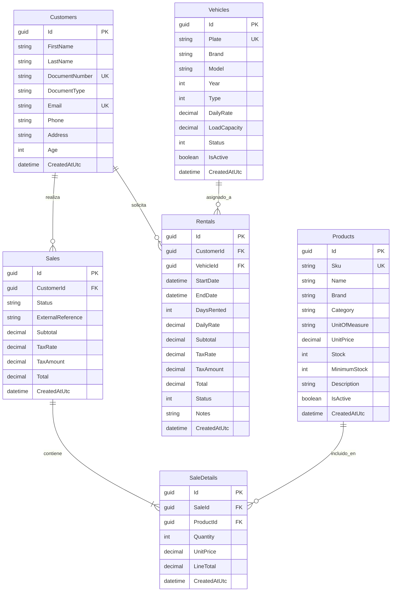
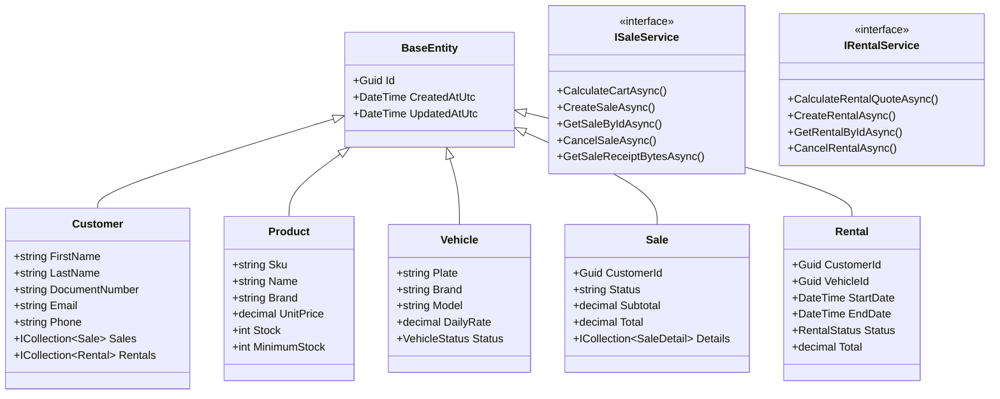

# Firmeza - Sistema de Gestión de Materiales de Construcción y Alquiler de Flota

Proyecto desarrollado en C# y .NET 10 bajo los principios de Clean Architecture Vanilla como solución backend Web API para la gestión integral de venta de materiales y alquiler de vehículos y maquinaria pesada.

## Descripción del Proyecto

Firmeza es una plataforma backend diseñada para centralizar dos líneas de negocio complementarias dentro del sector de la construcción:

1. **Venta y distribución de materiales de construcción:** control de catálogo de productos clasificados por marcas y SKU, control de inventario, detección automática de stock crítico, cálculo dinámico de carritos de compras con impuestos y facturación con generación de recibos PDF y notificaciones por correo.
2. **Alquiler de flota de vehículos y maquinaria:** gestión de camiones, maquinaria pesada y remolques, cotizador de costos por días de alquiler, control de estados de flota y prevención de solapamientos de fechas de reserva.

El sistema expone una API RESTful desacoplada consumida exclusivamente mediante peticiones HTTP por una aplicación cliente SPA desarrollada en Angular. La persistencia opera sobre PostgreSQL alojado en Supabase a través de Entity Framework Core, con seguridad administrada por ASP.NET Core Identity y tokens JWT.

---

## Diagramas de Arquitectura y Diseño


### 2. Diagrama Entidad-Relación (ER)



### 3. Diagrama de Clases (Dominio y Servicios)



---

## Estructura del Proyecto

```text
Firmeza.API/
├── src/
│   ├── Firmeza.Domain/              # Entidades, Enums, Excepciones y Reglas puras
│   ├── Firmeza.Application/         # DTOs, Mappings, Interfaces, Servicios y FluentValidation
│   ├── Firmeza.Infrastructure/      # EF Core, Identity, Repositorios, ClosedXML, QuestPDF, MailKit
│   └── Firmeza.Api/                 # Controladores REST, Middlewares, Filtros, Scalar OpenAPI
├── tests/
│   └── Firmeza.Tests/               # Suite de pruebas unitarias xUnit + Moq
├── Dockerfile                       # Multi-stage build para imagen de producción de la API
├── Dockerfile.tests                 # Contenedor para ejecución automatizada de pruebas
├── docker-compose.yml               # Orquestación con pruebas previas y variables de entorno
└── README.md
```

---

## Instrucciones de Configuración y Ejecución

### 1. Clonar el repositorio
```bash
git clone git@github.com:Esthercita-Factory/artyomalvarez-Firmeza.API.git
cd artyomalvarez-Firmeza.API
```

### 2. Configurar Secretos de Usuario (.NET User-Secrets)
Configurar la cadena de conexión a PostgreSQL y la contraseña del administrador en el almacén seguro de .NET:

```bash
dotnet user-secrets set "ConnectionStrings:DefaultConnection" "Host=aws-0-us-east-1.pooler.supabase.com;Port=5432;Database=postgres;Username=postgres.tu_usuario;Password=tu_contraseña;SSL Mode=Require;Trust Server Certificate=true" --project src/Firmeza.Api
dotnet user-secrets set "AdminUser:Password" "TuClaveSeguraAdmin2026!" --project src/Firmeza.Api
dotnet user-secrets set "Jwt:Key" "ClaveSuperSeguraDeAlMenos32CaracteresParaProduccion!" --project src/Firmeza.Api
```

### 3. Compilar y Ejecutar Pruebas Unitarias
```bash
dotnet build
dotnet test --logger "console;verbosity=normal"
```

### 4. Ejecución Local con Docker y Docker Compose
Para compilar y ejecutar todo el entorno (ejecutando las pruebas primero antes de iniciar la API):

```bash
# Ejecutar suite completa con docker compose
docker compose up --build
```

O para ejecutar solo el contenedor de pruebas unitarias:
```bash
docker build -f Dockerfile.tests -t firmeza-tests .
docker run --rm firmeza-tests
```

### 5. Documentación Interactiva de la API
Con la aplicación en ejecución en modo de desarrollo, la documentación interactiva con soporte Bearer Token se encuentra disponible en:
- Scalar API Reference: `http://localhost:5000/scalar/v1`
- OpenAPI Specification: `http://localhost:5000/openapi/v1.json`
