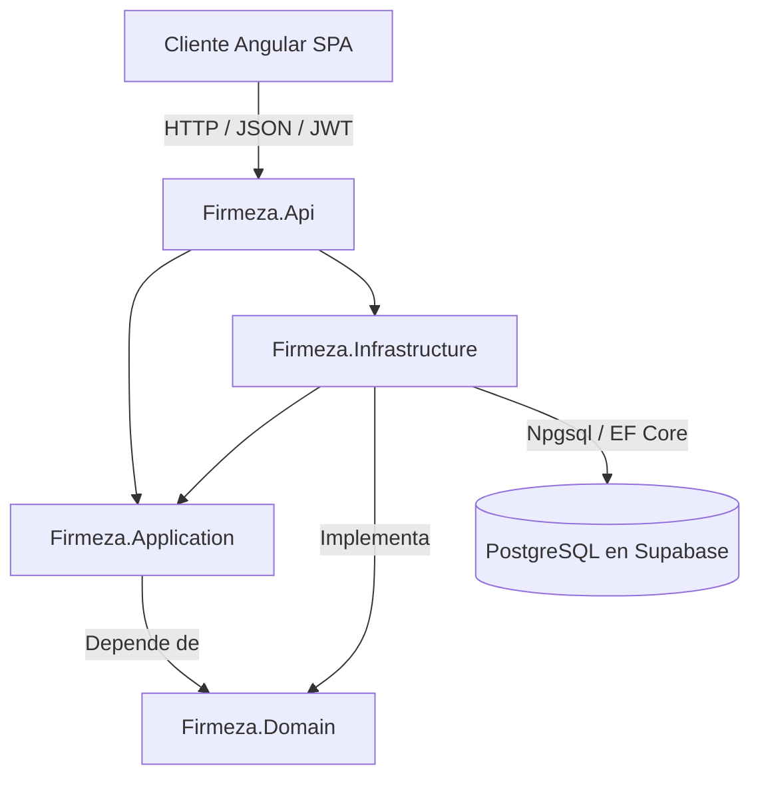
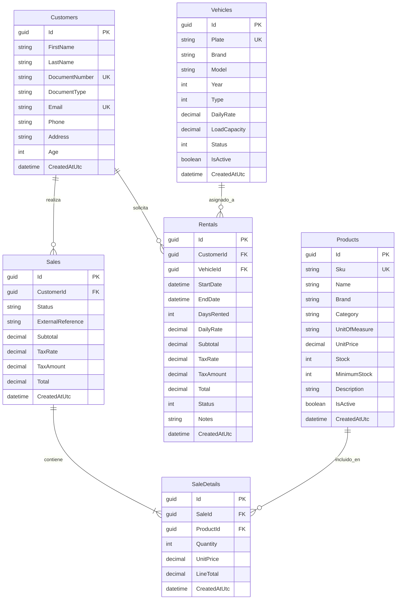
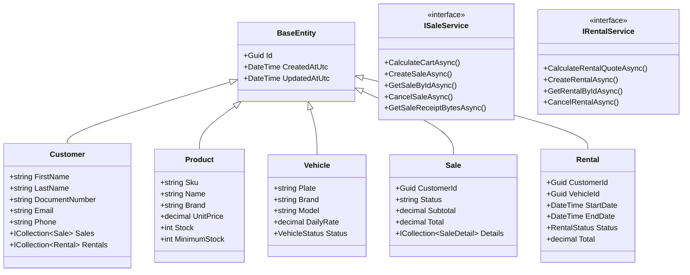

# Firmeza - Sistema de Gestión de Materiales de Construcción y Alquiler de Flota

Proyecto desarrollado en C# y .NET 10 bajo los principios de Clean Architecture Vanilla como solución backend Web API para la gestión integral de venta de materiales y alquiler de vehículos y maquinaria pesada.

## Descripción del Proyecto

Firmeza es una plataforma backend diseñada para centralizar dos líneas de negocio complementarias dentro del sector de la construcción:

1. **Venta y distribución de materiales de construcción:** control de catálogo de productos clasificados por marcas y SKU, control de inventario, detección automática de stock crítico, cálculo dinámico de carritos de compras con impuestos y facturación con generación de recibos PDF y notificaciones por correo.
2. **Alquiler de flota de vehículos y maquinaria:** gestión de camiones, maquinaria pesada y remolques, cotizador de costos por días de alquiler, control de estados de flota y prevención de solapamientos de fechas de reserva.

El sistema expone una API RESTful desacoplada consumida exclusivamente mediante peticiones HTTP por una aplicación cliente SPA desarrollada en Angular. La persistencia opera sobre PostgreSQL alojado en Supabase a través de Entity Framework Core, con seguridad administrada por ASP.NET Core Identity y tokens JWT.

---

## Diagramas de Arquitectura y Diseño

### 1. Diagrama de Arquitectura de Capas



### 2. Diagrama Entidad-Relación (ER)



### 3. Diagrama de Clases (Dominio y Servicios)



---

## Estructura del Proyecto

```text
Firmeza.API/
├── src/
│   ├── Firmeza.Domain/              # Entidades, Enums, Excepciones y Reglas puras
│   ├── Firmeza.Application/         # DTOs, Mappings, Interfaces, Servicios y FluentValidation
│   ├── Firmeza.Infrastructure/      # EF Core, Identity, Repositorios, ClosedXML, QuestPDF, MailKit
│   └── Firmeza.Api/                 # Controladores REST, Middlewares, Filtros, Scalar OpenAPI
├── tests/
│   └── Firmeza.Tests/               # Suite de pruebas unitarias xUnit + Moq
├── Dockerfile                       # Multi-stage build para imagen de producción de la API
├── Dockerfile.tests                 # Contenedor para ejecución automatizada de pruebas
├── docker-compose.yml               # Orquestación con pruebas previas y variables de entorno
└── README.md
```

---

## Requisitos del Sistema
- **.NET 10 SDK**
- **Node.js 20+** y **npm**

---

## 🚀 Cómo Ejecutar la Solución (Listo para Probar)

El proyecto viene completamente preconfigurado con conexión activa a PostgreSQL en la nube (Supabase), por lo que **no requiere instalar base de datos local ni configurar archivos**.

### Paso 1: Iniciar la API (.NET 10)
Abre una terminal en la raíz de la carpeta y ejecuta:
```bash
dotnet run --project src/Firmeza.Api --launch-profile http
```
* **API Web en ejecución:** `http://localhost:5054`
* **Documentación interactiva Scalar:** `http://localhost:5054/scalar/v1`
* **Swagger OpenAPI:** `http://localhost:5054/openapi/v1.json`

---

### Paso 2: Iniciar el Frontend (Angular 20)
Abre una segunda terminal y ejecuta:
```bash
cd Firmeza.Client
npm install
npm start
```
* **Aplicación Web en el navegador:** `http://localhost:4200`

---

## 🔑 Usuarios de Prueba

| Rol | Correo | Contraseña | Acceso |
| :--- | :--- | :--- | :--- |
| **Administrador** | `admin@firmeza.com` | `Admin123*Password` | Ingreso en `/login` o botón **"Panel Admin"** (`/admin`) |
| **Cliente** | `cliente@firmeza.com` | `Cliente2026*` | Ingreso en `/login` o registro en `/registro` |

---

## 💡 Nota de Arquitectura: Módulo Administrativo (`Firmeza.Admin`)
Por acuerdo arquitectónico documentado en los lineamientos técnicos del proyecto, el módulo administrativo base no se implementó en páginas monolíticas Razor (`.cshtml`), sino desacoplado dentro de una arquitectura cliente-servidor moderna:
* **Frontend:** Se integró dentro de la SPA en Angular (`Firmeza.Client`) bajo la ruta protegida `/admin/*` con `adminGuard`, protegiendo el acceso exclusivo para usuarios con rol `Administrador`.
* **Backend Web API:** Expone los controladores administrativos completos (`/api/Dashboard/metrics`, `/api/Products`, `/api/Customers`, `/api/Sales`, `/api/Rentals`, `/api/Excel`) consumidos mediante peticiones RESTful autenticadas con Bearer JWT.

---

## 🧪 Pruebas Unitarias Automatizadas (xUnit)
Para ejecutar la suite de 29 pruebas unitarias de lógica de negocio (IVA, inventario, cotizaciones, seguridad):
```bash
dotnet test
```

---

## 🐳 Docker (Opcional)
Si se desea ejecutar en un servidor con Docker disponible:
```bash
docker compose up --build
```
*(Los archivos Dockerfile, Dockerfile.tests, nginx.conf y docker-compose.yml ya están incluidos y configurados).*
