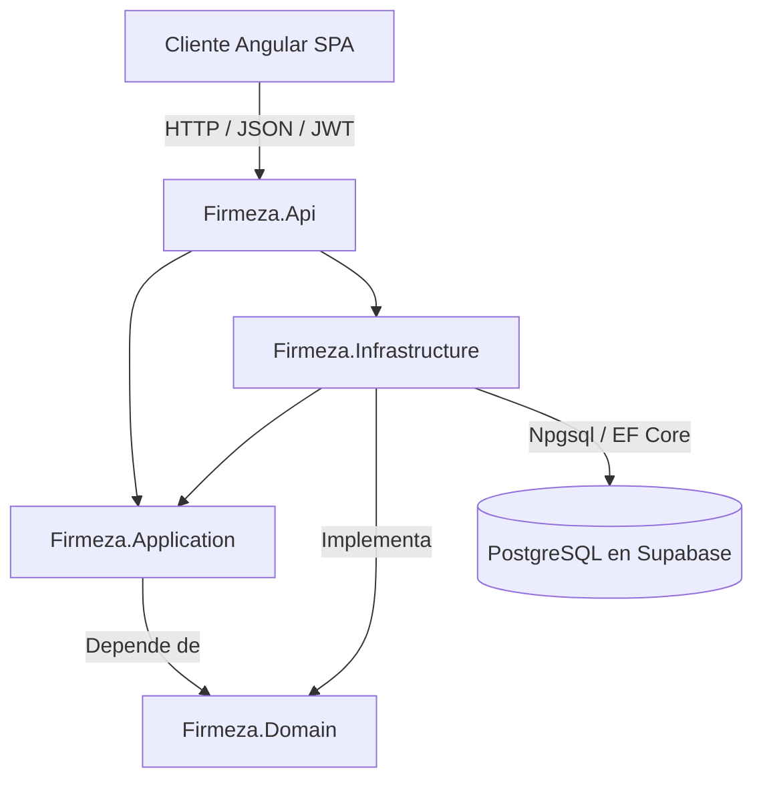

# Firmeza - Sistema de Gestion de Materiales de Construccion y Alquiler de Flota

Proyecto desarrollado en C# y .NET 10 bajo los principios de Clean Architecture Vanilla como solucion backend Web API para la gestion integral de venta de materiales y alquiler de vehiculos y maquinaria pesada.

## Descripcion del Proyecto

Firmeza es una plataforma backend diseñada para centralizar dos lineas de negocio complementarias dentro del sector de la construccion:

1. Venta y distribucion de materiales de construccion: control de catalogo de productos clasificados por marcas y SKU, control de inventario, deteccion automatica de stock critico y calculo dinamico de carritos de compras con impuestos.
2. Alquiler de flota de vehiculos y maquinaria: gestion de camiones, maquinaria pesada y remolques, cotizador de costos por dias de alquiler, control de estados de flota y prevencion de solapamientos de fechas de reserva.

El sistema expone una API RESTful desacoplada consumida exclusivamente mediante peticiones HTTP por una aplicacion cliente SPA desarrollada en Angular. La persistencia opera sobre PostgreSQL alojado en Supabase a traves de Entity Framework Core, con seguridad administrada por ASP.NET Core Identity y tokens JWT.

## Conceptos de Arquitectura y .NET Aplicados

A lo largo del desarrollo de la solucion se aplicaron las siguientes practicas y estandares de ingenieria de software:

### 1. Clean Architecture Vanilla
La solucion esta estructurada en cuatro capas con una estricta regla de dependencias unidireccionales hacia el centro:
- Firmeza.Domain: Nucleo puro del negocio. Contiene las entidades, enumeradores y excepciones de dominio. No tiene dependencias de ningun paquete externo ni de infraestructura.
- Firmeza.Application: Casos de uso, interfaces de repositorios, interfaces de servicios, DTOs, perfiles de AutoMapper y validadores con FluentValidation.
- Firmeza.Infrastructure: Implementacion de la persistencia con ApplicationDbContext (EF Core con PostgreSQL/Npgsql), repositorios, DbInitializer para siembra de datos, integracion con MiniExcel, QuestPDF y MailKit.
- Firmeza.Api: Capa de presentacion HTTP. Controladores RESTful, middleware de manejo global de excepciones, middleware de cabeceras de seguridad, configuracion de CORS para Angular, autenticacion JWT y documentacion con Scalar y OpenAPI.

### 2. Principios de Programacion Orientada a Objetos y SOLID
- Encapsulamiento: Entidades con propiedades controladas y clases base reutilizables.
- Herencia y Polimorfismo: BaseEntity con soporte nativo para identificadores Guid v7 secuenciales y marcas de tiempo UTC.
- Inversion de Dependencias: Todos los controladores y servicios dependen exclusivamente de interfaces de repositorio (IProductRepository, IVehicleRepository, ICustomerRepository, ISaleRepository, IRentalRepository, IUnitOfWork) y de servicios externos (IExcelService, IPdfService, IEmailService).

### 3. Seguridad, Identidad y Roles
- ASP.NET Core Identity: Manejo de usuarios con almacenamiento hash seguro de contraseñas.
- Control de Acceso Basado en Roles (RBAC): Separacion estricta entre Administrador (gestion total, modificacion de stock, metricas, gestion de flota) y Cliente (consulta publica, cotizaciones y compras).
- Tokens JWT Bearer: Autenticacion sin estado con claims de usuario y rol incorporados.
- Politica CORS: Configuracion especifica para permitir la comunicacion con el cliente Angular en http://localhost:4200.

### 4. Manejo Global de Excepciones y Middleware
- GlobalExceptionHandlerMiddleware: Intercepta DomainException, NotFoundException, ValidationException y excepciones no controladas para generar respuestas JSON estructuradas y codigos de estado HTTP semanticos (400, 404, 409, 500).
- SecurityHeadersMiddleware: Proteccion contra ataques comunes inyectando cabeceras de seguridad HTTP en todas las respuestas.

### 5. Identificadores Secuenciales de Alto Rendimiento
- Uso de Guid.CreateVersion7() de .NET 10 para todos los identificadores primarios. Estos identificadores combinan una marca de tiempo con aleatoriedad, garantizando orden cronologico nativo y optimizando los indices B-Tree en PostgreSQL.

## Diagrama de Arquitectura



## Estructura de Carpetas

```text
Firmeza.API/
├── src/
│   ├── Firmeza.Domain/
│   │   ├── Common/              # BaseEntity, DomainException, eventos base
│   │   ├── Entities/            # Product, Customer, Vehicle, Sale, SaleDetail, Rental
│   │   └── Enums/               # VehicleType, VehicleStatus, RentalStatus, SaleStatus
│   │
│   ├── Firmeza.Application/
│   │   ├── Common/              # Excepciones de aplicacion y MappingProfile
│   │   ├── DTOs/                # DTOs clasificados por modulo (Products, Vehicles, Sales, etc.)
│   │   ├── Interfaces/
│   │   │   ├── External/        # IExcelService, IPdfService, IEmailService
│   │   │   └── Persistence/     # Repositorios especificos y IUnitOfWork
│   │   ├── Services/            # Logica de aplicacion (SaleService, RentalService, DashboardService)
│   │   └── Validators/          # Reglas de validacion con FluentValidation
│   │
│   ├── Firmeza.Infrastructure/
│   │   ├── Identity/            # ApplicationUser y configuracion de ASP.NET Core Identity
│   │   ├── Persistence/         # ApplicationDbContext, configuraciones Fluent API y migraciones
│   │   │   ├── Repositories/    # Implementacion de repositorios con EF Core
│   │   │   └── Seeds/           # DbInitializer (creacion automatica de roles y admin inicial)
│   │   └── Services/            # Implementaciones de ExcelService, PdfService y EmailService
│   │
│   └── Firmeza.Api/
│       ├── Controllers/         # Auth, Products, Vehicles, Customers, Sales, Rentals, Dashboard
│       ├── Middlewares/         # GlobalExceptionHandlerMiddleware, SecurityHeadersMiddleware
│       ├── Program.cs           # Configuracion del host, pipeline HTTP y servicios DI
│       ├── appsettings.json     # Configuracion base
│       └── appsettings.Development.json
│
├── Firmeza.sln                  # Archivo de solucion de .NET
├── Directory.Build.props        # Configuraciones globales de compilacion
└── README.md                    # Documentacion del proyecto
```

## Endpoints Principales de la API

### Autenticacion (api/Auth)
- POST /api/Auth/register: Registro de nuevos usuarios con rol Cliente asignado por defecto.
- POST /api/Auth/login: Inicio de sesion que retorna token JWT, fecha de expiracion, identificador, correo y lista de roles.
- GET /api/Auth/me: Obtiene la informacion y roles del usuario autenticado actual.

### Productos y Materiales (api/Products)
- GET /api/Products: Catalogo general de productos activos (Acceso publico).
- GET /api/Products/{id}: Detalle especifico de un producto (Acceso publico).
- GET /api/Products/low-stock: Listado de materiales con inventario igual o inferior al stock minimo (Requiere rol Administrador).
- POST /api/Products: Creacion de un nuevo producto (Requiere rol Administrador).
- PUT /api/Products/{id}: Actualizacion de informacion o inventario de producto (Requiere rol Administrador).
- DELETE /api/Products/{id}: Eliminacion logica de producto (Requiere rol Administrador).

### Flota de Vehiculos (api/Vehicles)
- GET /api/Vehicles: Listado de vehiculos con filtros opcionales por tipo y estado (Acceso publico).
- GET /api/Vehicles/{id}: Informacion tecnica y tarifa diaria de un vehiculo (Acceso publico).
- POST /api/Vehicles: Alta de nuevo vehiculo o maquinaria pesada (Requiere rol Administrador).
- PUT /api/Vehicles/{id}: Actualizacion de datos de flota (Requiere rol Administrador).
- DELETE /api/Vehicles/{id}: Baja de vehiculo (Requiere rol Administrador).

### Clientes (api/Customers)
- GET /api/Customers: Listado de clientes registrados (Requiere rol Administrador).
- GET /api/Customers/{id}: Consulta de cliente por identificador unico.
- GET /api/Customers/by-document/{documentNumber}: Consulta de cliente por numero de documento de identidad.
- POST /api/Customers: Registro de perfil de cliente con documento, nombre, direccion y contacto.
- PUT /api/Customers/{id}: Actualizacion de datos de cliente.

### Ventas (api/Sales)
- GET /api/Sales: Listado de ventas registradas, con filtro opcional por cliente.
- GET /api/Sales/{id}: Detalle completo de una venta con desglose de articulos.
- POST /api/Sales/calculate: Calculo preliminar del carrito de compras (subtotal, IVA y total) validado contra existencias.
- POST /api/Sales: Creacion y confirmacion de compra con descuento automatico del stock en base de datos.

### Alquileres (api/Rentals)
- GET /api/Rentals: Listado de contratos de alquiler vigentes e historicos.
- GET /api/Rentals/{id}: Consulta de contrato de alquiler por identificador.
- POST /api/Rentals/quote: Cotizador en tiempo real calculando dias habiles, tarifa diaria e IVA segun rango de fechas.
- POST /api/Rentals: Registro y formalizacion del contrato de alquiler previniendo solapamiento de fechas.

### Panel Administrativo (api/Dashboard)
- GET /api/Dashboard/metrics: Metricas consolidadas de ventas totales, alquileres activos, alertas de stock bajo y disponibilidad de flota (Requiere rol Administrador).

## Requisitos del Sistema

- .NET SDK version 10.0 o superior.
- PostgreSQL 15 o superior (o conexion activa a proyecto Supabase).
- Git para control de versiones.
- Terminal de comandos (Bash, Zsh, PowerShell o CMD).

## Instrucciones de Configuracion y Ejecucion

### 1. Clonar el repositorio
```bash
git clone git@github.com:Esthercita-Factory/artyomalvarez-Firmeza.API.git
cd artyomalvarez-Firmeza.API
```

### 2. Configurar la cadena de conexion
Configurar la cadena de conexion a PostgreSQL en el almacen seguro de secretos de usuario de .NET:

```bash
dotnet user-secrets set "ConnectionStrings:DefaultConnection" "Host=aws-0-us-east-1.pooler.supabase.com;Port=5432;Database=postgres;Username=postgres.tu_usuario;Password=tu_contraseña;SSL Mode=Require;Trust Server Certificate=true" --project src/Firmeza.Api
```

### 3. Restaurar dependencias y compilar
```bash
dotnet restore
dotnet build
```

### 4. Ejecutar la API
```bash
dotnet run --project src/Firmeza.Api
```

Al iniciar, el sistema ejecutara automaticamente el sembrador de base de datos (DbInitializer) para garantizar la existencia de los roles base y del usuario administrador inicial:
- Correo administrador: admin@firmeza.com
- Contraseña por defecto: Admin123*

### 5. Documentacion Interactiva de la API
Con la aplicacion en ejecucion bajo el entorno de desarrollo, la documentacion interactiva esta disponible en:
- Scalar API Reference: http://localhost:5000/scalar/v1 (o puerto asignado en consola)
- OpenAPI Specification: http://localhost:5000/openapi/v1.json
